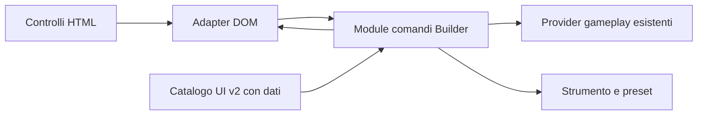

# Revisione architetturale — 19 novembre 2026

Base runtime esaminata: `main` `168b993b`; riallineato a `origin/main` `faf36510` dopo il solo aggiornamento documentale WEBSITE-SRS. Branch: `refactor/architecture-20261119`, non ancora integrato. La PR hardening #285 resta separata.

## Perimetro e metodo

Ricognizione dell'intero inventario `src/` (191 file JS/MJS sulla base, 65.029 righe incluse le copie generate), punti d'ingresso `index.html` e `camp/index.html`, unica API telemetry, schema Supabase, tooling e suite QA. Approfondimento dei proprietari di stato, dipendenze dei classic script, duplicati, override globali e collegamento UI/gioco. Asset Blender, vendor e contenuto editoriale generato sono stati classificati come dati generati: non riscritti a mano né conteggiati come monoliti da spezzare.

Metodo della skill improve-codebase-architecture: cercare Module con Interface piccola e Implementation sostanziale; usare il deletion test per distinguere duplicati reali da differenze di dominio. Revisione strutturale dell'intera base, non lettura manuale certificata di ogni riga né certificazione di correttezza di tutti i sottosistemi.

## Interventi implementati

### ARCH-01 — Comandi Builder dietro un'unica Interface

Prima: `settlement-app-input.js` costruiva strumenti, quote e preset dentro gli handler HTML. `ui/game-api.js` leggeva pulsanti `.active` e la UI v2 passava selettori CSS a `press()`, anche per controlli staccati dal documento dalla palette compatta.

Ora: `ConquerBuilderCommands.execute(request)` riceve dati per una sola scelta, applica i limiti esistenti, chiama i provider proprietari di costi/spec e aggiorna lo strumento. `options()` legge i preset senza interrogare pulsanti. `subscribe()` consente all'Adapter DOM di sincronizzare i marcatori visivi. L'Adapter `settlement-builder-controls.js` cattura i controlli prima che la palette li stacchi. La UI v2 porta dati nel catalogo e usa `ConquerGame.commands.builder` direttamente. Il codice di collocamento, i costi e la simulazione restano nei rispettivi owner.

I comandi non dipendono da `document`; il `setTool` esistente conserva i suoi effetti di presentazione. Non si dichiara quindi conclusa la separazione generale stato/rendering. `press()` resta per comandi non Builder e per il selettore materiale lean-to già non implementato: nessuna nuova meccanica aggiunta implicitamente.

Benefici: Locality delle scelte e dei preset; Leverage dei test sulla stessa Interface usata da entrambe le UI; nessun click nascosto necessario per i comandi migrati. Rimossi 145 righe circa di costruzione strumenti dal modulo degli eventi pointer/keyboard, senza duplicarle in una seconda UI.

### ARCH-02 — Espansione dei modelli indicizzati

Tre implementazioni locali in civic3d/house3d/wood3d espandevano gli stessi indici in Float32 e conservavano cache per chiave testuale. Ora `ConquerMesh3D.modelParts(model)` concentra l'Implementation e usa una WeakMap per identità del record modello. Registri con nomi uguali restano isolati; rimpiazzare un record ricrea l'espansione; i vecchi registri non sono trattenuti dalla cache. I record modello sono snapshot immutabili; la mutazione in-place della geometria non è un contratto supportato.

Preservati ordine delle parti, byte Float32 dei vertici, riferimento e ordine degli indici colore e fallback delle case con un pezzo mancante. La regressione confronta tutti i 77 modelli / 265 parti / 227.073 vertici dei tre cataloghi.

Events3D non è stato forzato in questa Interface: separa tessuti animati e parti rigide con dati vento per vertice. Anche i due painter Mesh3D/Wagons3D hanno differenze reali di winding, backface, bias e shading: non sono duplicati intercambiabili.

### ARCH-03 — Facciate: una sola Implementation attiva

`settlement-facade-polish.js` sovrascriveva funzioni definite in architecture.js. Consolidata in architecture la versione realmente attiva di `gothicAssetSizeForLevel`; eliminati il file di override, il pittore Canvas `drawArchitectureAssetOnEdge` privo di chiamanti e la maschera emissiva usata solo da quel painter.

Conservati loader PNG, `architectureSprite` e `facadeAssetWorldSpan`: questi sono usati dal renderer World3D. Rimuoverli perché vicini al codice morto avrebbe rotto le facciate. Matrice livelli/tier, caricamento dei nove PNG e span proiettato sono coperti dal nuovo test comportamentale. Dimensioni e aspetto attivo non sono stati intenzionalmente cambiati.

## Aree esaminate e prossime opportunità

| Area | Esito | Prossimo intervento sensato |
|---|---|---|
| Builder/input/UI | ARCH-01 implementato | Migrare gli altri comandi legacy uno alla volta; sostituire i monkey-patch di notifica con emissioni esplicite solo dopo aver censito i chiamanti |
| Modelli e renderer | ARCH-02/03 implementati | Separare generazione geometria, materiali e invio al renderer nei file grandi; preservare differenze effettive fra painter |
| Persistenza | Strong | Snapshot/restore comune dietro due Adapter locale/cloud. Coordinare con le protezioni della #285; nessun doppio formato nuovo |
| Percorsi veicoli/messaggeri/cartelli | Worth exploring | Module per lunghezze cumulative, posizione e inversione; heading e pianificatori restano specializzati |
| Bootstrap index/CAMP | Worth exploring | Manifest verificato/generato dei classic script, preservando ordine sincrono e differenze di modalità |
| Economia e lavoro L1/L2 | Nessuna nuova astrazione necessaria | `setTierMinimum/Auto/Order` e `staffTasks` sono già condivisi; mantenere allocatore e ledger unici |
| Combattimento e assedio | File grandi, non duplicato automaticamente | Separazione per ordini, decisione e aggiornamento combattenti richiede prima contratti dati e fixture di assedio; non estrarre funzioni con decine di globali soltanto per accorciare il file |
| Navigazione e territorio | Planner con responsabilità diverse | Evitare un nuovo planner generale; profilare e consolidare solo primitive geometriche semanticamente identiche |
| QA e CI | Copertura ampia, parte dei test è testuale | I nuovi test attraversano le Interface; aggiornati i check che imponevano il vecchio collocamento del codice, preservando gli invarianti di dominio |
| API e Supabase | Esaminati nel rapporto hardening #285 | Telemetry disabilitata e RLS nello schema versionato; nessun cambio o verifica del database live in questa revisione |

I maggiori concentratori di responsabilità sulla base sono `settlement-world.js` (2.720 righe), `settlement-combat.js` (2.493), `settlement-world3d.js` (2.188), `settlement-core.js` (1.398). Le dimensioni guidano l'approfondimento, non giustificano una migrazione generale o un nuovo motore parallelo.

## Verifica e limiti

- PASS comandi Builder: preset, limiti porte piccole/lignee, livelli, materiali, prerequisiti, notifiche, Adapter con controlli staccati, 94 scelte del catalogo UI v2 e snapshot dell'effettivo ConquerGame.
- PASS Chromium: gioco classico, UI v2 e CAMP; selezione strumenti, preset, limiti porte e cava argilla, rail Preact e uso diretto con query di selezione disabilitata nella UI v2; nessun errore di pagina. Screenshot locali sotto `output/playwright/architecture/`.
- PASS espansione modello byte per byte e facciate; regressioni civic3d/wood3d/house3d/events3d/houses3d/gate-fittings/built-portico.
- Eseguite tutte le 220 suite `qa/*-regression.cjs`: primo giro 218 PASS, un check testuale della vecchia UI aggiornato e rieseguito PASS (crime-buildings), un limite temporale founding rieseguito PASS sul branch e sulla base. Nessuna soglia allentata. PASS anche i nuovi check di contratto e sintassi su 193 file runtime.
- Un primo giro sotto carico ha superato la soglia temporale della fondazione (136 ms). Isolato: main PASS (massimi 29/32 ms), branch PASS (20/20 ms). Il planner e la soglia non sono stati modificati; resta una sensibilità al carico locale, non una certificazione prestazionale generale.
- Cinque test runtime telemetry/diagnostica e i due export Codex PASS. Audit visivo completo avviato con `node qa/asset-audit.mjs`, report e fogli locali in `output/playwright/architecture/asset-audit/`; esito da aggiornare a fine verifica.
- CI remota da verificare nella PR. Nessun merge o deployment. Roadmap prodotto invariata; contratto architetturale registrato in DECISIONS.
