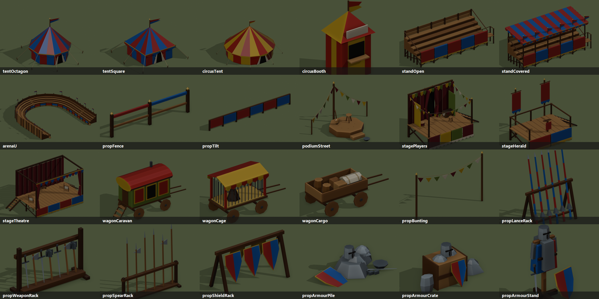
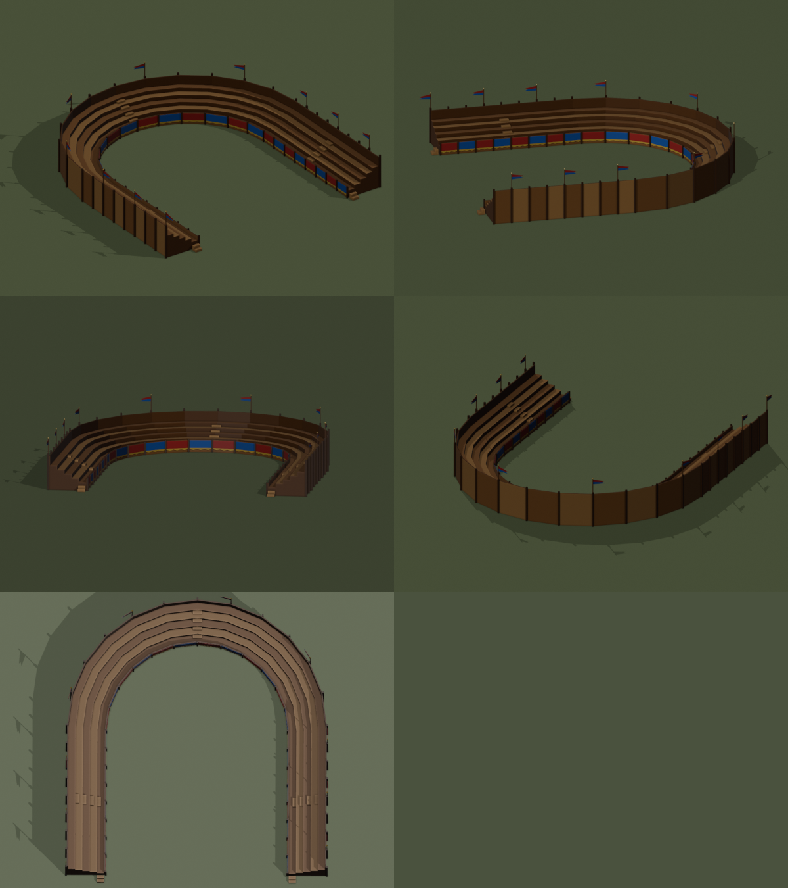

# CONQUER — Events skeleton (V0)

This folder defines the initial contracts for social events. It intentionally does not activate gameplay or alter the main simulation.

## Spaces
- **Street performance spot**: player-placed small location; spontaneous performance by one artist or a pair, with a small audience.
- **Stage**: player-placed permanent performance platform; group performances with audience.
- **Festival ground**: player-placed, fixed 14 × 10 world-unit rectangular reservation (D-044; the first skeleton said 6 × 10), green when idle. It is not a constructed building: no materials, labor, or build time. Blocks houses, fields, pastures, buildings and other reservations, but allows normal civilian traversal while idle. Relocatable when no event is active or being assembled. No automatic scanning of empty terrain to discover event locations.

## Event lifecycle
`planned -> preparing -> active -> clearing -> idle` (cancellation allowed before active).
- Spontaneous street performances require an available performer and valid placed spot, and are not player-scheduled.
- Scheduled events (festivals, fairs, traveling circus, tournaments, jousts) require an explicit date/time window, a compatible placed venue, and no conflicting booking.
- Temporary props (tables, tents, stands, barriers, tournament lists) spawn within the venue only during preparation/active phases and despawn during clearing.
- Population joins as spectators/performers using existing routines and pathfinding; attendees temporarily suspend compatible jobs and return afterwards.
- Food and gold consumption, morale, attractiveness and prestige are *hooks*, not active effects until wired to the economy.

## 3D models (present on `events`)
Blender catalog `tools/blender/build_events.py` → `src/assets/event-models.js`; runtime `src/settlement-events3d.js` (`window.ConquerEvents3D`), drawn by the 2.5D painter and the WebGL builder. QA: `qa/events3d-regression.cjs`.

Venue structure contract (data only until the venue registry exists):
`{type:'eventVenue', venue, x, y, angle, dressing?, w?, h?, event?:{setup, phase, progress?}}`

| Venue | Footprint (U) | 3D |
|---|---|---|
| `streetSpot` | 1.6 × 1.6 | `podiumStreet`: octagonal podium, stool, lute, coin hat, bunting pole |
| `stage` | 2.4 × 1.2 | same base, dressing `players` (`stagePlayers`: backcloth, wings, bunting) or `herald` (`stageHerald`: lectern, realm banners) |
| `arenaLot` | 18 × 14 | permanent lot: the U arena (sand field, honour box, gate towers) with eight participants' tents, racks, armour, wagons and scatter goods, always shown |
| `festivalGround` | 14 × 10 (long side on local x) | green pad when idle; setup props during `preparing` (appear with `progress`), `active`, `clearing` (leave with `progress`) |

Festival ground setups (local layout in `SETUPS`, validated inside the ground with no overlaps):
- `joust`: lists over 10 U long (three-segment tilt) with two covered stands on one side and two open stands on the other, knights' tents in the corners, lance, shield and weapon racks, armour stands;
- `circus`: big top, two smaller tents, three caravans, cage wagon, two baggage carts, barker's podium;
- `feast` (sagra): players' stage, four stalls, eight tables and two pergolas (civic props), barrel tables, two podiums;
- `tourney` (torneo, melee): fenced field (12 `propFence` segments, gates at both ends), two covered and two open stands, four knights' tents, racks and armour;
- circus also has two ticket booths, a juggler podium, bunting lines and scatter goods; the feast has sixteen tables and bunting over them.
- extra: `camp` (knights' camp), `theatre` (theatre stage facing two open stands). The U arena moved to its dedicated `arenaLot`.

Livery: stands, arena and stages follow the realm heraldry (`State.heraldry` c1 / c2 / c4). Knights' tents, lance and shield racks and armour take a deterministic random pair of primary colours per instance. Circus, bunting and stage cloths keep fixed festive colours. Model `meta` carries seats, performer, speaker and entrance points for the future attendance module.

Wind: pennons, bunting, gonfalons and the arena gate banners are marked as cloth in the builder (part `f`: weight 0 at the anchor .. 1 at the free end, wave direction). `settlement-events3d.js` keeps them out of the static scene and returns them every frame from `dynamicMeshes()` (WebGL `drawFront`, 2.5D overlay, like the mill sails): a travelling wave that grows with the weather's wind and runs only while the game runs.

Joust life (`src/settlement-events-joust.js`, `window.ConquerJoust`): on an active `joust` ground, townsfolk sit on about two seats in three of the stands and cheer the clash; two knights in primary-colour liveries charge down either side of the tilt every 10 s, cross at mid-lists and one of them is unhorsed (thrown off the lane, lies in the sand, gets up and walks back to his horse); bouts alternate ends. Grooms hold spare horses at both ends and squires shuttle lances and shields between the tents and the lists. 2D figures (villagers, soldiers, the 2D horse of `ConquerAnimals.drawAnimal`) drawn with the population, on a clock that runs only while the game runs. `scene(venue, t)` is pure; QA `qa/joust-regression.cjs`.

People and CANS (`src/settlement-events-people.js`, `window.ConquerEventPeople`), aligned with `docs/CANS-ARCHITECTURE.md` (branch `cans`): `slots(venue)` turns the models' points into ActivitySlot-like records with stable ids (venue id : item : action : n), role `guest`/`worker` and action (`sit`, `stand`, `watch`, `perform`, `announce`, `sell`, `browse`, `queue`) — stands' seats, tables and barrel stools, stall sellers and customers, stage and podium performers and their audiences, booth sellers and queues. `occupants(venue)` is the occupancy register (one occupant per slot, one slot per occupant); until the CANS adapters exist it is filled by a deterministic **provisional** source of anonymous extras (`provisional:true`), replaceable with `setOccupancySource(fn)`. The joust, feast and circus scenes draw registered occupants only; an empty slot shows nobody. Feast: diners, sellers, dancing players, storytellers and audiences, strollers whose sequence visits other stalls. Circus: calling barker, juggler, booth sellers, queues, and the head of each queue walking into the big top. Arena lot, stage and podium are always lived in (`venueScene`): spectators on the arena tiers roaring at each hit, two combatants (`fight` slots) duelling in the sand, a squire (`prepare` slot) before each participant's tent carrying lances; actors and their audience on the players' stage, a crier on the herald's stage; a musician and a storyteller on the podium with listeners. QA `qa/event-people-regression.cjs`.

Leisure catalog (24 models):  · arena views: 

## Modules to integrate (future implementation)
1. Venue registry and placement validation / occupancy reservations.
2. Event catalog with venue compatibility, capacity and resource hooks.
3. Schedule and conflict checks, using the existing game clock.
4. Lifecycle manager and deterministic cleanup / save-load.
5. NPC attendance and performer assignments via existing routines.
6. Temporary SVG asset placement; reuse combat engine for tournaments rather than implementing separate combat.

## Acceptance criteria
- Placement/removal of a 14×10 festival ground reserves terrain without a construction bar.
- No building, field or pasture may overlap the reserved rectangle.
- Idle ground remains visually green and passable.
- The player schedules an event only on a placed compatible venue.
- Props and crowds appear during an event and are cleaned up afterwards.
- No automatic discovery of vacant terrain and no new alcohol resource.

Status: **architecture skeleton only**. No runtime behavior is claimed.
